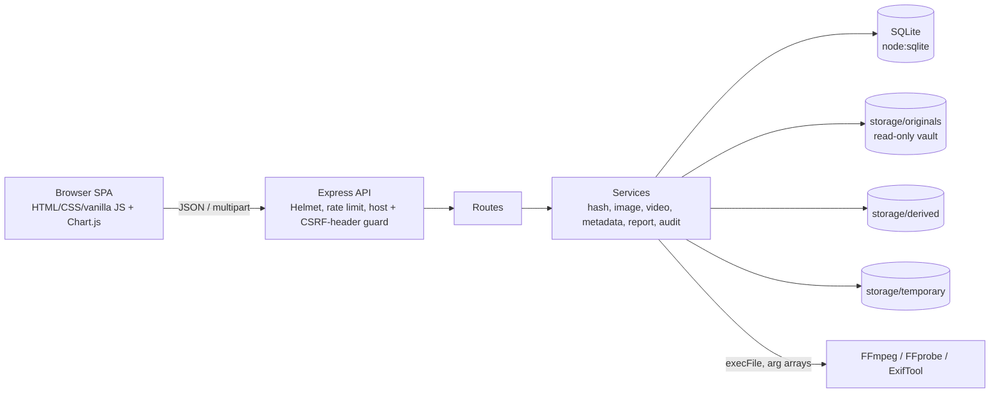
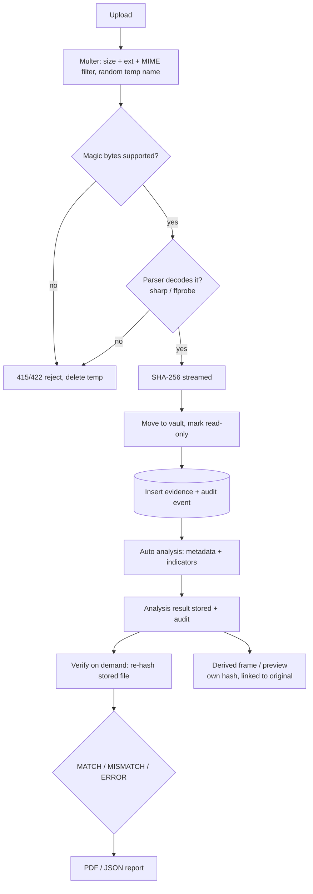
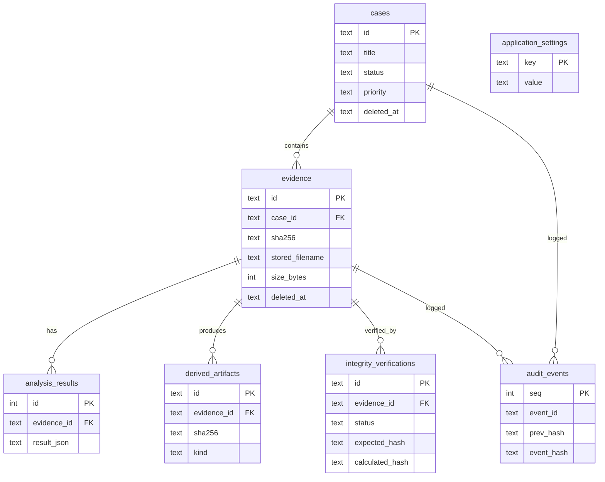

# ForenSight - Digital Image & Video Forensics and Evidence Integrity System

A Cyber Security and Digital Forensics (CSDF) mini project: a local web application for managing forensic cases, ingesting image/video evidence, extracting metadata, verifying SHA-256 integrity, keeping a hash-linked audit log and exporting PDF/JSON reports.

> **Evidence-handling notice.** ForenSight is for a **trusted local environment**. Handle evidence only with proper authorization. Nothing is uploaded to third-party services. Do not expose the server publicly (it binds to `127.0.0.1` by default and has no user login).

## 1. Abstract
Digital photos and videos are routinely used as evidence, yet most people cannot easily show that a file is the same file that was collected. ForenSight records a SHA-256 fingerprint at ingestion, keeps the original untouched in a vault outside the web root, performs all analysis on read-only access or derived copies, and logs every action in an append-only, hash-linked audit trail.

## 2. Problem statement
Evidence files are copied, renamed, re-encoded and annotated by many hands. Without an integrity baseline, metadata review and a handling log, it is hard to tell whether a file changed after collection, and hard to document what was done to it.

## 3. Objectives
1. Ingest image/video evidence safely (signature + parser validation, random storage names).
2. Record and re-verify SHA-256 hashes (streaming) with explicit MATCH / MISMATCH / ERROR results.
3. Extract EXIF / container metadata and show **preliminary** indicators without over-claiming.
4. Derive frames/previews without ever modifying originals.
5. Keep an append-only, hash-linked audit log.
6. Produce case, evidence and verification reports (PDF + JSON).

## 4. Scope
In scope: JPG/JPEG/PNG/WebP and MP4/MOV/WebM; single-machine use; SQLite persistence.
Out of scope: pixel-level tamper detection, deepfake detection, multi-user auth, legal certification of chain of custody, cloud deployment.

## 5. Existing vs proposed system
| Existing (manual) | ForenSight |
|---|---|
| Hash computed ad hoc with separate tools | Hash recorded at ingest, re-verified on demand, history kept |
| Metadata read with different tools, copied by hand | One metadata view with copy buttons and parser status |
| Notes in spreadsheets | Case-linked records, analyst notes, audit trail |
| Reports typed manually | PDF/JSON reports separating facts, metadata, indicators, notes |

## 6. Requirements
**Functional:** case CRUD with soft delete; evidence upload/search/sort/filter/paginate; image + video analysis; frame extraction and contact sheet; integrity verification (incl. user-supplied hash); audit log with chain verification; PDF/JSON reports; settings; light/dark themes.
**Non-functional:** originals never modified; no shell string concatenation; request/upload limits; timeouts and concurrency limits for FFmpeg; graceful degradation when FFmpeg/ExifTool are missing; Windows + PowerShell support; no paid services or API keys.

## 7. Architecture


## 8. Evidence-processing flow


## 9. Modules
- `services/hashService.js` streaming SHA-256, constant-time hex compare.
- `services/imageService.js` sharp decode check, properties, structural tail check (JPEG EOI / PNG IEND), derived copies.
- `services/metadataService.js` ExifTool when installed; otherwise a built-in EXIF reader (IFD0/Exif/GPS basics).
- `services/videoService.js` FFprobe metadata, frame extraction, contact sheet, timeouts, concurrency slots.
- `services/evidenceService.js` ingest, analyze, verify, derived artifacts.
- `services/auditService.js` hash-linked append-only log + chain verification.
- `services/reportService.js` PDFKit reports and JSON exports.
- `middleware/uploadValidation.js` multer + signature/parser validation. `middleware/errorHandler.js` central error handling, no stack traces to clients.

## 10. Database design

Schema: `database/schema.sql`. `audit_events` has `BEFORE UPDATE` / `BEFORE DELETE` triggers that abort, so even the app's own SQL cannot change history. Cases and evidence use soft deletion (`deleted_at`); stored files and audit history are retained.

## 11. API (all JSON: `{ok:true,data}` / `{ok:false,error:{code,message,details?}}`)
State-changing requests must send `X-Requested-With: ForenSight` (the bundled UI does).

| Method & path | Purpose |
|---|---|
| GET `/api/health` | status + tool availability |
| GET `/api/dashboard/stats`, `/api/dashboard/activity`, `/api/search?q=` | dashboard data, global search |
| GET/POST `/api/cases`, GET/PUT/DELETE `/api/cases/:id` | case CRUD (`DELETE ...?confirm=true` archives) |
| GET `/api/evidence` | list (`q, caseId, type, sort, order, page, pageSize`) |
| POST `/api/evidence/upload` | multipart: `caseId`, `file`, `notes` |
| GET/PUT/DELETE `/api/evidence/:id` | detail, notes, archive (`confirm=true`) |
| GET `/api/evidence/:id/preview`, `/download` | inline preview; download (audited) |
| POST `/api/evidence/:id/analyze`, GET `/analysis` | run / read analysis |
| POST `/api/evidence/:id/verify` | body `{expectedHash?}` -> MATCH/MISMATCH/ERROR |
| GET `/api/evidence/:id/verifications`, `/artifacts` | history, derived artifacts |
| POST `/api/evidence/:id/video/frame` `{timestamp}` | frame extraction |
| POST `/api/evidence/:id/video/contact-sheet` `{count}` | contact sheet |
| POST `/api/evidence/:id/image/derive` `{mode}` | preview / grayscale / contrast copy |
| GET `/api/artifacts/:id/preview`, `/download` | derived files |
| GET `/api/evidence/:id/report?format=pdf\|json` | evidence report |
| GET `/api/reports/case/:caseId?format=pdf\|json` | case report |
| GET `/api/verifications/:id/report?format=pdf\|json` | integrity verification report |
| GET `/api/audit`, `/api/audit/types`, `/api/audit/verify-chain` | read-only audit access |
| GET/PUT `/api/settings` | alias, contact-sheet limit, tool status |

## 12. Requirements
**Software:** Windows 10/11, **Node.js 22.13 or newer (LTS)**, npm, a modern browser. Optional: FFmpeg (includes FFprobe), ExifTool.
**Hardware:** any PC with 4 GB RAM; disk space for evidence.
> The database uses Node's built-in `node:sqlite`, so no native SQLite compilation is needed on Windows. It prints an "ExperimentalWarning" on start-up; this is expected.

## 13. Windows installation (PowerShell)
```powershell
# 1. Check Node.js and npm (need Node >= 22.13)
node -v ; npm -v

# 2. Install dependencies (creates package-lock.json)
cd forensight
npm install

# 3. Create .env from the example
Copy-Item .env.example .env

# 4. Initialise the database (also happens automatically on start)
npm run db:init

# 5. Start the server
npm start
# -> http://127.0.0.1:3000   (open http://localhost:3000)

# 6. Run tests (new window)
npm test

# 7. Health check
Invoke-RestMethod http://localhost:3000/api/health | ConvertTo-Json -Depth 5

# 8. Check FFmpeg / FFprobe / ExifTool
npm run check:tools
ffmpeg -version ; ffprobe -version ; exiftool -ver
```
Demo data: set `DEMO_MODE=true` in `.env` and restart (records are labelled DEMO and are synthetic).

### FFmpeg (video features)
1. Download a Windows build (e.g. "release essentials") from https://www.gyan.dev/ffmpeg/builds/ and extract to `C:\ffmpeg`.
2. Add `C:\ffmpeg\bin` to the system **Path** (Environment Variables) and open a **new** PowerShell window.
3. `ffmpeg -version` and `ffprobe -version` should print versions. Alternatively set `FFMPEG_PATH` / `FFPROBE_PATH` in `.env` to the full `.exe` paths.

### ExifTool (richer image metadata, optional)
Download the Windows executable from https://exiftool.org, rename `exiftool(-k).exe` to `exiftool.exe`, put it in a folder on `Path` (or set `EXIFTOOL_PATH`). Without it, ForenSight uses a limited built-in EXIF reader.

### Environment variables
`HOST` (127.0.0.1), `PORT` (3000), `MAX_UPLOAD_MB` (100), `ALLOWED_HOSTS`, `DEMO_MODE`, `DEFAULT_ACTOR`, `FFMPEG_PATH`, `FFPROBE_PATH`, `EXIFTOOL_PATH`, `PROCESS_TIMEOUT_MS` (60000), `MAX_CONCURRENT_JOBS` (2), `MAX_CONTACT_SHEET_FRAMES` (12), optional `STORAGE_DIR`, `DB_PATH`.

### Troubleshooting
| Symptom | Check |
|---|---|
| `npm install` fails | Node version (`node -v` >= 22.13); network/proxy; run PowerShell as normal user |
| `EADDRINUSE` | another app uses the port: `Get-NetTCPConnection -LocalPort 3000` or change `PORT` |
| Upload says unsupported | extension/MIME not allowed, or the file signature is not JPG/PNG/WebP/MP4/MOV/WebM |
| Upload 413 | file exceeds `MAX_UPLOAD_MB` |
| `EPERM` / `EACCES` on storage | folder is read-only or synced/locked by antivirus; check `storage\` permissions: `icacls storage` |
| Video page shows setup guidance | FFmpeg/FFprobe not on `Path`; reopen PowerShell after editing Path |
| `403 bad_host` | you opened the app through a hostname other than localhost/127.0.0.1; add it to `ALLOWED_HOSTS` |
| Charts/icons missing | `npm install` did not finish (they are served from `node_modules`) |

## 14. Security design
Helmet + strict CSP (no inline scripts); rate limiting; 64 KB JSON limit; upload size limit; ext + MIME + magic-byte + parser validation; random 192-bit storage names (original filename kept only in the database); vault outside `public/` and never served statically; downloads and previews go through ID-validated routes; parameterised SQL everywhere; FFmpeg/ExifTool run with `execFile` argument arrays, timeouts, output caps and a concurrency limit; temporary files removed in `finally`; originals set read-only and never opened for writing; Host-header allow-list (DNS-rebinding guard) and a required custom header on state-changing requests (CSRF guard); errors never include stack traces or file paths; all UI output is HTML-escaped.
No login is implemented on purpose (an "accept anything" login would be fake security). For multi-user use, add real authentication with hashed passwords, sessions and CSRF tokens before exposing it beyond one machine.

## 15. Forensic notes and limitations
- A matching SHA-256 shows **byte-level consistency with the recorded hash**, assuming the baseline hash and records were not themselves compromised. It does **not** prove authenticity, origin or admissibility.
- EXIF/container metadata is self-reported and editable. Missing metadata is normal and never treated as tampering.
- Indicators are heuristic and preliminary. ForenSight does not claim reliable manipulation detection.
- The hash-linked audit log helps expose out-of-band edits; it is **not** a legally certified chain of custody, and a whole-chain rewrite by someone with database access is not prevented.
- Actor names are self-declared aliases; identity is not verified.
- Preview requests are not individually logged (to avoid log flooding); downloads, analyses, verifications, derived artifacts, reports and changes are.
- Browser playback depends on the codec (e.g. some MOV/HEVC files may not play in-page even though analysis works).

## 16. Future enhancements
Real authentication and roles; signed/timestamped hash anchors; more formats (HEIC, AVI, MKV); perceptual hashing and duplicate detection; PRNU/ELA research modules clearly labelled experimental; batch import; report templates; Docker packaging.

## 17. Sample test workflow
1. Create case "Sample Case 001". 2. Upload a JPG with EXIF; note the recorded SHA-256. 3. Open Image Analysis: check metadata and indicators. 4. Create a grayscale derived copy and compare side by side. 5. Verify integrity -> MATCH. 6. In PowerShell, tamper with a **copy** of the vault file to demonstrate detection (see below). 7. Upload an MP4, extract a frame at 1.5 s. 8. Export PDF + JSON reports. 9. Open Audit Log -> Verify hash chain.

Tamper demo (instructor-visible, on the stored file of a throw-away test item):
```powershell
$f = Get-ChildItem storage\originals | Select-Object -First 1
Set-ItemProperty $f.FullName -Name IsReadOnly -Value $false
Add-Content -Path $f.FullName -Value "x" -NoNewline
# now click "Verify now" -> MISMATCH
```

## 18. Demonstration checklist
- [ ] `npm start`, dashboard loads, theme toggle works in both modes
- [ ] Create / edit / filter / archive a case
- [ ] Upload valid image + video; try an `.exe` and a renamed text file (rejected)
- [ ] Image metadata + indicators; derived copy + comparison
- [ ] Video metadata; frame extraction; contact sheet
- [ ] Verify MATCH; tamper -> MISMATCH; hash comparison with a pasted value
- [ ] PDF + JSON reports; audit log; hash-chain verification
- [ ] Explain limitations slide (hash != authenticity; metadata editable)

## 19. Viva questions and answers
1. **What does SHA-256 prove here?** That the bytes now equal the bytes hashed at ingestion. Not origin, authenticity or admissibility.
2. **Why stream the file for hashing?** Constant memory regardless of file size.
3. **Why not trust the file extension?** It is trivially renamed; we check magic bytes and run a real parser.
4. **Why keep uploads outside `public/`?** So evidence can only be reached through authorised, audited routes.
5. **How do you preserve originals?** Random name, read-only, never opened for write; analysis reads or works on derived copies with their own hash.
6. **Missing EXIF - is the image fake?** No. Screenshots and social platforms strip it; it is only Informational.
7. **How is the audit log tamper-evident?** Each event stores `prev_hash` and its own hash; triggers block UPDATE/DELETE; `verify-chain` recomputes everything.
8. **Limits of that log?** Someone with full DB access could rewrite the whole chain; it is not legally certified.
9. **How do you stop command injection?** `execFile` with argument arrays, validated numeric inputs, server-generated paths.
10. **What if FFmpeg is missing?** Video tools show setup guidance; everything else works.
11. **Why soft delete?** Evidence-linked records and history must stay available for review.
12. **Why SQLite?** Zero-setup, single-file, adequate for a local single-user tool.
13. **How is CSRF handled without cookies?** Custom header requirement + cross-site fetch blocking + localhost-only binding.
14. **Why no login?** Honest scope: local single-user. A fake login would be worse than none.
